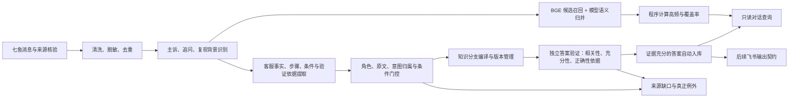

# 知汇鸽商家支持 VOC 算法规范

## 1. 目标与业务边界

七鱼是采集渠道，咨询主体是使用知汇鸽的商家。分析对象是商家在电商平台与知汇鸽之间使用功能、配置机器人和排查异常的实际问题。

每次整理同时产出三类结果：

1. **高频咨询主题**：商家集中遇到哪些软件能力、使用目标和异常现象。
2. **可复用知识**：有出处的功能说明、配置方法、条件化排查建议和经原记录验证的临时处理办法。
3. **例外与来源缺口**：真正冲突、无法绑定的条件、缺少人工答复、待关联背景和无法安全拆分的混合口径。

商品名称、SKU、规格、价格、订单状态和转述的买家问法，优先作为复现背景。只有来源明确证明它们改变了软件操作的适用条件，才进入知识范围。

## 2. 四条独立判断轴

| 判断轴 | 解决的问题 | 取值与约束 |
| --- | --- | --- |
| 咨询主线 | 商家正在咨询什么 | 场景配置与使用指导；功能异常与排障；背景待识别 |
| 诊断状态 | 当前查明了什么 | 商家报告、待定位、配置原因已确认、平台限制已确认、缺陷已确认、普通使用指导 |
| 知识可复用性 | 当前回复能沉淀什么 | 功能说明、配置指导、排查建议、原记录已验证的临时办法、待来源/例外 |
| 客户反馈闭环 | 客户是否接受本次解答 | 明确操作成功、接受解释、弱闭环、继续疑问/失败、反馈未知；接受解释不等于修复成功 |

“平台后台已设置，但机器人未触发”先形成异常报告。确认产品缺陷需要当前人工原话中的明确确认依据。

“如果使用子账号同步商品，请检查该子账号的商品权限”可以形成受条件限制的排查建议。客户是否完成检查、实际根因是否查明、效果是否恢复，分别保留状态。

模型字段 `resolved_answer` 表示原答包含可提炼的解答或操作，不代表客户工单已经解决。工单进度和验证效果单独判断。

## 3. 数据对象与证据

逻辑中心是**咨询事件**：一个商家的一个实际目标或异常现象，以及相关提问、追问、背景和客服回应。

输入至少保留：原生会话 ID、访客身份键、原始消息 ID、方向、发送者信息、消息类型、时间、原文及采集来源。去重使用原始消息身份；不能仅用昵称、脱敏后的显示名或相同文本合并不同访客。

这里的客户身份来自七鱼访客标识；未建立店铺、账号与企业之间的映射前，不把访客数宣称为独立店铺数或企业数。

当前实现以问答记录和有界会话上下文装载数据，意图与事实最终映射到消息及字符跨度。事实引用来自当前可验证的问答；旁邻上下文用于理解主诉和指代。完整跨问答的事件证据图属于后续增强项。

人工角色由程序依据真实来源核验。消息上的正数 `staffId` 不能单独证明发送者是客服。历史拉取和推送之间需比较消息身份与覆盖，优先保留更完整、已验证的原始记录。

每条事实的引用保留：

```text
source: question | answer
quote: 精确原文
start/end: 清洗后来源中的字符跨度
role: merchant | staff | unknown
source_refs: 原始消息 ID + 消息内跨度
```

角色、位置和消息映射由程序计算。模型负责选择与理解，不能自行宣布引用真实。

## 4. 完整处理流程



### 4.1 清洗与来源核验

- 解析消息结构，附件元数据与会话正文分开；保留图片等占位及消息身份。
- 统一可见文本和必要的脱敏处理，保留原文快照，保证引用可回溯。
- 排除机器人、系统消息冒充人工答案的情况；无人工回答的主诉仍可参与高频统计。
- 保留时间、平台、版本、否定、数量和前置条件；不补写图片里尚未取得的事实。

### 4.2 识别主诉与背景

一次来源可包含多个目标；每个目标关联真实、不重叠的提问跨度。

- 直接的软件操作请求、陈述式异常和有明确目标的追问，都属于候选主诉。
- 纯 SKU、规格、店名、截图和占位回复可先记录为背景。
- 口语省略宾语时，可用**当前已验证人工答句**里的明确软件对象消歧；当前答句必须与该问答绑定。
- 通知、人工代办、纯商品政策和邻接的别条回答，不能用来制造当前软件诉求或事实。

咨询对象、当前步骤、根因和效果分别提取。大模型对背景/主诉给出明显不相容的标签时，使用受控反馈纠错。

### 4.3 高频主题归并

归并键的语义是：

```text
软件能力 / 模块 + 商家使用目标或报告现象
```

本地 BGE 召回至多五个候选，大模型比较真实目标、来源样例和业务边界。相似度用于召回和疑似重复提示，不能单独证明两个问题相同。

同一触发异常下的不同 SKU、版本、排查阶段和已确认原因，保留为属性及知识分支。不同软件能力、不同目标和不同现象继续分开。

主题以能力与现象为标题，第一条具体问法标为“代表问法”。代表问法中的某个商品或业务场景，不成为全部成员的限制。

主频率按以下口径计算：

```text
consultation_count(topic)
  = COUNT(DISTINCT 会话身份, 商家身份, topic_id)

mention_count
  = 可验证的不同咨询片段数
```

重复提问与补截图可以增加片段数，同一会话中的同一主题不重复增加主咨询次数。统计、比例和时间对比由程序计算，并显示已整理覆盖范围。

“高频”优先呈现按上述口径排序的实际数量及占比，不凭模型生成次数。数量门槛如需配置，应同时显示观察时间和样本覆盖；数据未整理完成时，不把已处理样本占比写成全量客户占比。

### 4.4 提取事实与条件

大模型输出标准问法、事实候选、操作、条件、原因状态与验证依据。程序重新核对：

1. 引文是否真实存在于指定来源。
2. 是否属于当前咨询意图及正确发送者。
3. 是否保留完整含义、主语、否定、数字和必要前提。
4. 已确认原因是否有明确人工确认依据。
5. 已验证效果是否有原记录中的明确验证依据。

通用 `scope`、领域字段及已认证客服原句中的必要前提统一投影到 `applicability`。知识显示范围、分支身份与冲突比较使用一致的条件来源。源里已有版本限制时，模型漏填冗余字段不能使版本消失。

### 4.5 分开工单缺口与知识缺口

| 情况 | 处理 |
| --- | --- |
| 客户尚未确认账号类型，但客服给了完整条件化权限检查 | 保存排查建议及条件，诊断与效果继续待确认 |
| 仅要求店铺名、截图或等待结果，没有可复用方法 | 保留咨询与接待原话，不编成解决知识 |
| 所问恢复时间、参数值明确未知 | 保留真正缺口，不能用别的动作冒充已回答 |
| 缺必要文件/对象而无法独立给出所需方案 | 扣留对应知识，保留所缺依赖 |
| 模型标注了阻塞缺口，引文却未证明阻塞语义 | 精确、合法的标注可进入非权威 `gap_audit`；不成为事实，独立来源门控继续生效 |
| 非法结构、非原文、跨意图引用 | 拒绝该提取并执行有预算的纠错 |

`gap_audit` 只记录模型分析注记。真正未答、未知所问结果、关键依赖缺失的拦截不能依赖模型是否填写了 `missing_info`。

### 4.6 编译知识分支

| 知识类型 | 内容 | 自动入库的前提 |
| --- | --- | --- |
| `capability_fact` 功能说明 | 明确的软件功能或限制 | 当前人工原句有依据，时间/版本/范围完整 |
| `configuration_guide` 配置指导 | 明确的配置流程 | 操作对象与必要前提可绑定，步骤可复用 |
| `troubleshooting_advice` 排查建议 | 条件化检查或建议操作 | 原句完整、有明确软件目标，原因与效果保守标注 |
| `verified_workaround` 原记录已验证的临时办法 | 特定条件下的绕行处理 | 原记录有明确确认、验证及适用范围 |

知识标题取本分支有证据的目标或标准问法。正文从已验证的人工事实与步骤重建，原句和消息身份一起保存。

同一主题可拥有多个原因、条件和方法分支。待定位事件不会阻断其他完整方法。同一适用条件下的真正矛盾进入例外；不能把矛盾数值写成不同“范围”来隐藏冲突。可选参数策略与互斥的必要限制分别判断。

复杂无标点长句若同时混合当前软件限制、后续人工承诺而无法安全拆分，先扣留。人工代办时间不属于软件功能的生效范围。

### 4.7 独立答案验证：不能把引用准确当成结论正确

目标是自动产出有充分依据、可在明确条件下复用的正确答案，不设置所有条目都必须人工确认的审批步骤。提取器产生候选，验证器逐项裁决；不能用“模型觉得可信”替代验证。

本系统以**会话闭环证据**为主要验证来源：同一问题的客户主诉、客服解释与操作、客户后续反馈，以及是否再次提出相关疑问。不要求客户先准备外部官方文档或逐条审批。

**不同证据分开保存：**

| 证据 | 能证明什么 | 不能证明什么 |
| --- | --- | --- |
| 当前客服原话、真实消息与完整引文 | 来源真实，当前工作人员作过该说明或建议 | 该功能口径一定正确、该方法已经生效 |
| 匹配目标和条件的复测、客户确认及处理结果 | 在所述个案和条件下观察到的效果 | 所有相同现象都具有相同原因 |
| 多个独立会话中相同适用条件、相同答法和无反证的接受结果 | 该受限答法有重复的实际接待支持 | 频次本身等于功能真值，或可以去掉原条件 |
| 后续如有匹配版本的产品材料 | 可作为额外核对依据 | 本算法必须依赖外部资料才能运行 |

相同说法出现很多次、多位客服重复、两个模型判断一致，都不单独构成正确性证明。验证模型是语义检查器，不是新的事实来源。核心是完整上下文中的实际接受结果、适用范围和反证。

**同一问题的反馈分级：**

| 反馈状态 | 例子与判定 | 可沉淀的结论 |
| --- | --- | --- |
| 明确成功 | 客户在对应操作后明确反馈恢复正常、操作成功；后面没有重新报错 | 该实例在对应条件下操作有效 |
| 明确接受/理解 | 对完整解释回应明白、知道如何操作，且没有后续同问题异议 | 客户接受该解答；不自动宣称故障已修复 |
| 闭环无异议 | 完整会话中答复后转入其他话题或自然结束，无同问题疑问 | 弱接受证据；须与完整解答及多个独立一致闭环共同判断 |
| 仍有疑问/失败 | 继续问原问题、仍不行、反馈报错、需升级或否定刚才方法 | 不把这版答法作为已验证答案；继续寻找后续真正闭环 |
| 未知 | 单纯不回复、等待人工处理、记录截断、只有访客方向、会话尚在进行 | 不能把缺少记录当成没有疑问 |

“好的但是还是不行”不能因出现“好的”判接受。感谢发生在操作前、对另一问题的确认、客服自己说好了，都不能冒充客户对当前答案的验证。同一会话先失败后成功时，保留失败尝试，提炼最终被接受的方法及必要上下文。

每个候选按以下顺序裁决，任何必要项不通过都不能靠平均分抵消：

1. **问题相关性**：答案是否回应当前商家的软件目标或异常，排除邻接回答、商品政策和人工通知。
2. **逐条支持**：拆成原子结论；每条结论均有可定位证据，生成的话术不得新增功能、参数、保证或承诺。
3. **条件完整性**：原前提、步骤依赖、否定、数值、权限、平台、版本和时间全部保留；不以压缩话术为由扩大范围。
4. **解答充分性**：所问内容是否实际得到回答；询问恢复时间不能由“重新登录”冒充已回答，条件排查也不能冒充已解决。
5. **闭环依据**：核对同一咨询的后续客户反馈和实际结果；明确接受与明确修复分别记录。仅有客服说法时只能认定“原话支持”，无后续消息不能升级为客户认可。
6. **冲突与时效**：检索相同适用范围的相反口径、版本变更和失效证据；真实冲突阻断自动正确答案。
7. **表述等价性**：对最终可复用话术再核对一次证据，确保润色没有把“可尝试”变成“必然恢复”，没有把“当前暂不支持”变成永久限制。

逻辑判定为：

```text
自动可用答案 = 相关 ∧ 有逐条依据 ∧ 条件完整 ∧ 回答充分
             ∧ 具备该类结论要求的会话闭环证据 ∧ 无当前反证 ∧ 表述不越界
```

输出分为：

- **会话验证通过**：证据满足该类答案的全部必要条件，自动入库，可在限定范围直接复用，无需逐条人工批准。明确成功与接受解释使用不同证据标记。
- **有依据的排查建议**：检查动作与前提有来源，但原因或效果尚未确认；可以作为条件建议使用，不能作为确定的修复结论。
- **待补证据**：缺相关客户反馈、结果验证、关键参数或完整上下文；自动保留咨询和缺口，不生成确定答案。
- **冲突/失效**：保留冲突来源或失效原因，停止该答案的自动使用。

弱接受不能只靠出现次数。只有完整解答、相同适用条件、独立客户会话、一致的最终答法和无未解释反证共同成立，才可按保守阈值自动采用。首版阈值为两个独立弱闭环；阈值与支持/反对样本数在证书中保留，不能包装成统计保证。一个来源仍有同问题疑问时，不能用另一个来源的好评抵消。

后续收到有效新回复、复测结果或版本变化时，自动重跑对应候选的验证，更新独立知识版本。待补证据不等于强制交给人工逐条确认；人工只处理无法自动解决的真正例外。

**当前实现边界**：原话编译与会话反馈证书独立。`ready` 表示有来源的知识，`conversation_verification.auto_reusable` 才表示闭环规则通过；默认答案视图使用后者。证书只读复核完整官方快照、真实消息锚点、访客身份、后续先后关系和可确定的接受/反对表达，歧义保留未知。筛选不能隐藏同一知识分支的其他反证；缺失引用不能被默默省略。反馈变化动态更新证书，不要求重新调用模型提取原文。

当前答案采用经校验的客服原句和完整步骤编译，避免自由润色添加结论。自由口语的全面语义理解、跨会话重开关联及生成式改写后的独立语义验证，仍需单独扩展和评测。会话验证是实际接待结果支持，不能宣称数学意义的零误差或外部产品真值认证。

### 4.8 增量运行与模型适配

- 以来源指纹、提取合同版本、质量版本和模型缓存身份管理检查点。
- 新增或变化来源触发提取；质量规则变化可免费重编译已验证素材。
- 独立后台 worker 持久化任务；启动时固化模型配置，网页重启不终止模型任务。
- 每小时增量调度；无变化时跳过，有任务时避免并行生成。
- 一条来源最多一次自动纠错；每次尝试独立计调用、预留预算和已报告用量。连续三条来源最终失败时停止本轮，其余留待后续。

模型只通过统一 `Provider` 接口接入。当前网关使用 OpenAI 兼容协议；原生协议可实现适配器。业务代码不按“千问/GPT/DeepSeek”名称选择知识规则。

所有模型使用相同的规范化结构、来源校验、条件投影、知识门控和评测流程。字段解析与错误反馈属于协议层，知识真实性与统计属于业务层。

## 5. 伪代码

```python
for source in select_changed_sources():
    verified = normalize_and_verify_source(source)
    payload = extract_with_bounded_retry(provider, verified, topk_topics=5)
    intents = validate_refs_roles_and_intent_ownership(payload, verified)

    for intent in intents:
        if intent.is_background:
            save_context_fragment(intent)
            continue

        topic = resolve_topic(intent, local_semantic_candidates(intent))
        save_event(topic, intent)  # 频率由消息/会话身份计算
        facts = verified_staff_facts(intent)
        scope = project_all_proven_constraints(intent, facts)
        candidate = compile_source_supported_knowledge(facts, scope)
        decision = verify_answer(candidate, current_request=intent,
                                 conversation_outcome=trace_same_issue_feedback(intent),
                                 independent_source_guards=True)

        if decision.ready:
            append_versioned_knowledge(topic, facts, scope, decision.kind)
        else:
            save_specific_gap_or_exception(topic, decision)
```

## 6. 对话查询与飞书输出

对话流程：自然语言 → 固定只读查询计划 → Python 统计/BGE 检索 → 模型选择知识 ID → 程序回读当前有效版本 → 返回带条件和来源的答复。

查询需保留该次回答自己的时间、客户、客服与分类范围。知识版本、适用条件与关键原句不得为了缩短提示词而截断；超预算时舍弃整个候选。

飞书属于后续输出层，建议映射：知识 ID、主题 ID、版本、主线、功能对象、问题、正文、步骤、适用条件、诊断/验证状态、来源时间、原始消息引用和更新时间。使用稳定 ID 与版本幂等更新。当前重构不自动发送飞书或向客户发消息。

## 7. 验收与实现边界

必须覆盖：配置方法、相同现象不同 SKU、同现象不同原因、明确版本限制、已确认缺陷、条件化建议、口语续问、待通知、纯资料收集、纯商品背景、错位条件、必要依赖缺失和相同条件的冲突。

重点指标：

- 严重错误自动入库为零：虚构回答、访客冒充客服、丢数字/否定/必要条件、推测升级为已确认缺陷。
- 已入库事实全部具有真实消息与精确原文依据。
- 固定标注集的知识正例必须实际产出，不能用全部拒绝来取得“零错误”。
- 同义归并的精确率/召回率、真实知识正例召回率、背景误计率分别统计。
- 首遍完成、自动恢复、最终失败和实际调用次数分别记录。
- 合成回归、网络调用、离线重放与真实业务验收分别标识。

当前实现已具备问答/有界上下文装载、BGE 召回、统一提取、精确引用、条件投影、多分支编译、只读对话与小时任务。完整跨问答事件证据图、客户反馈与客服复测的更多验证等级、复杂口语原子命题拆分、外部知识校验及飞书推送，属于可继续增强的模块。

新增的“正确答案自动可用”验收要求需单独记录答案相关性、充分性、闭环证据类别、证据覆盖率和错误自动放行率。来源准确率与答案正确率分别评估，不能混报；缺少真实标注样本或完整后续消息时，不声称已经达到全部答案正确。

源码入口：`voc_engine.py` 编排，`voc_extract.py` 提取/归一化，`voc_domain.py` 领域约束，`voc_semantics.py` 召回，`voc_quality.py`/`voc_variants.py` 门控与分支，`voc_outcome.py` 会话闭环证书，`voc_assets.py` 派生存储，`voc_service.py` 任务，`voc_assistant.py` 对话。
